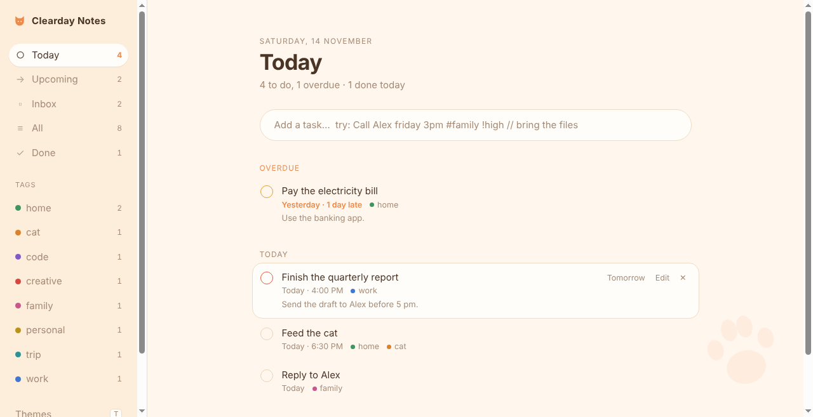
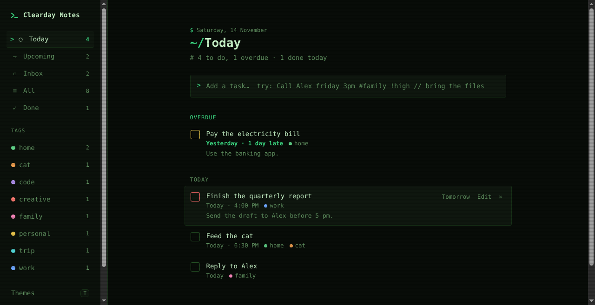
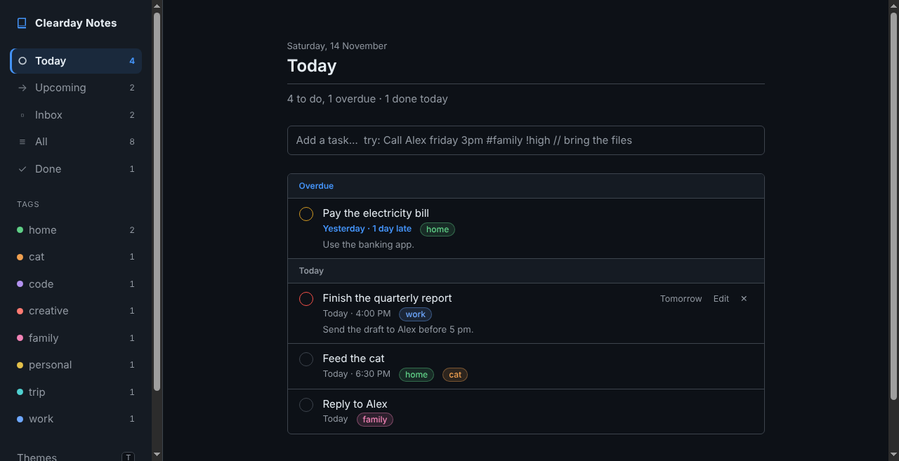
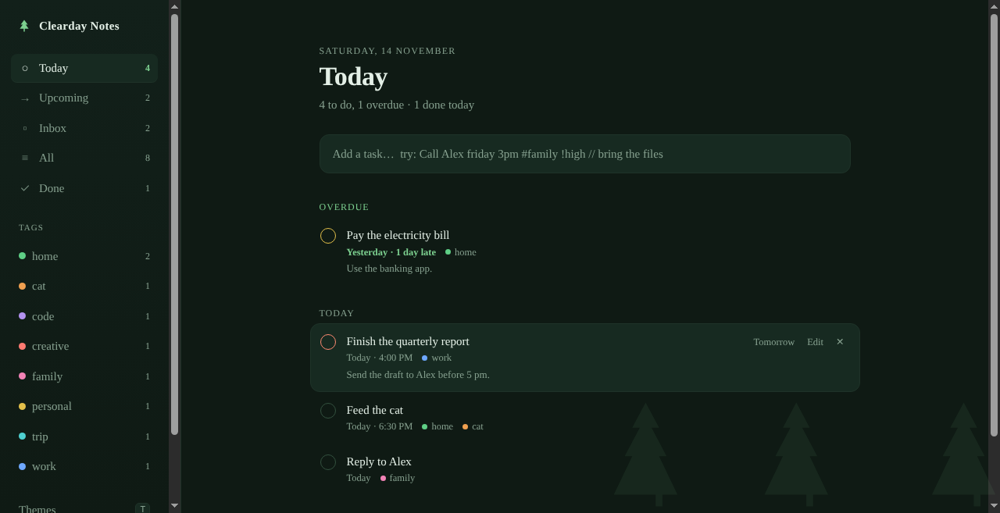

# Clearday Notes

**A minimalist, keyboard-first to-do list and notes app for your desktop.**
No account. No network. No dependencies. Your tasks never leave your machine.

**Clearday Notes** has one job: help you reach the end of the day with a clear list, with as little friction as possible.

| Cat (round and warm) | Terminal (programmer) |
| --- | --- |
|  |  |
| **Repo Dark** (issue-list style) | **Forest** |
|  |  |

More: [Paper](docs/screenshots/theme-light.png), [Midnight](docs/screenshots/theme-dark.png), [Sage](docs/screenshots/theme-sage.png), [Repo Light](docs/screenshots/theme-repo.png), [Ink](docs/screenshots/theme-ink.png), [theme picker](docs/screenshots/theme-picker.png), [focus mode](docs/screenshots/focus-terminal.png), [command palette](docs/screenshots/palette-dark.png).

## Ideas that shape the interface

* **One input, no forms.** Type a sentence; Clearday Notes understands it and shows what it understood as chips before you press Enter.
  `Call Alex friday at 3pm #family !high` becomes a task for Friday at 15:00, tagged *family*, high priority.
* **Today is the home screen.** Overdue work is separated and named plainly; everything else waits in Upcoming or Inbox.
* **Keyboard first, mouse friendly.** Press `?` for every shortcut, or `Ctrl K` for a command palette that also searches your tasks.
* **Editing is typing.** Editing a task shows the same sentence you would have typed, and re-parses it on Enter.
* **Nothing is final.** Complete, delete, snooze and import can all be undone, with `Z` or the toast.
* **Focus.** Press `F` to see one task alone, with an optional 25-minute timer.
* **Colour-coded labels.** Every `#tag` is a label with its own colour. Click the dot in the sidebar to change it, double-click the name to rename it everywhere.
* **Notes.** Anything after ` // ` is kept as a note under the task, never parsed: `Pack bag tomorrow // passport and charger`.
* **Ten themes.** Auto, Paper, Midnight, Sage, Forest (pines), Cat, Terminal (for programmers), Repo Light and Repo Dark (issue-list look), and Ink. Press `T` to choose. No badges, no nagging, and reduced motion is respected.

## Run it

Requires Node.js 20 or later. There is nothing to install.

```bash
git clone https://github.com/mokabah/clearday-notes.git
cd clearday-notes
npm start          # http://localhost:5173
```

**Single file.** `npm run build` produces `dist/clearday-notes.html`: the whole app in one file that works offline by double-clicking it.

In Chrome or Edge, open the address and choose *Install* in the address bar to use Clearday Notes as a standalone desktop window that also works offline. Alternatively, open the optional Electron shell:

```bash
cd electron && npm install && npm start
```

The Electron shell has not been run by the author (see [docs/QA_REPORT.md](docs/QA_REPORT.md)); the web version is the supported way to run Clearday Notes.

## Quick add reference

| Write | Meaning |
| --- | --- |
| `today`, `tomorrow`, `tonight`, `day after tomorrow` | a relative day |
| `friday`, `next friday`, `on mon` | a weekday (the coming one; `next` skips a week) |
| `in 3 days`, `in 2 weeks` | an offset |
| `2026-01-05`, `24/12`, `1/3/27` | an explicit date (day first) |
| `3pm`, `at 15:30`, `at 9`, `10:30 am` | a time (a time alone means today) |
| `#work` | a tag |
| `!`, `!!`, `!!!`, `!low`, `!medium`, `!high` | priority low, medium, high |
| `// text` | a note (kept verbatim) |
| `"…"` | wrap the whole line in quotes to keep it literal |

Full rules and known limits: [docs/PARSER.md](docs/PARSER.md).

## Keyboard

| Key | Action | Key | Action |
| --- | --- | --- | --- |
| `N` or `/` | add a task | `Z` / `Shift Z` | undo / redo |
| `J` `K` | move selection | `F` | focus mode |
| `Space` or `X` | complete | `1` `2` `3` | priority (with a task selected) |
| `E` or `Enter` | edit | `G` then `1`–`5` | go to a view |
| `S` | snooze to tomorrow | `T` | choose theme |
| `Delete` | delete | `Ctrl K` | command palette |

## Your data

Tasks are stored in your browser's `localStorage` on this machine only. Clearing site data erases them, so use *Export backup (JSON)* from the command palette now and then. Import merges a backup into your current list. A Markdown export is also available.

## Project layout

```
src/core/   pure logic: dates, quick-add parser, store with undo (unit-tested)
src/ui/     DOM, styles (all themes), keyboard, overlays
scripts/    static server, single-file bundler, static checks, end-to-end browser test
electron/   optional desktop shell
docs/       design notes, parser rules, QA report
```

## Development

```bash
npm test        # 42 unit tests
npm run check   # static checks
npm run e2e     # drives real headless Chrome through 17 user-level steps
```

See [CONTRIBUTING.md](CONTRIBUTING.md). Please read [docs/DESIGN.md](docs/DESIGN.md) first: it explains what Clearday Notes deliberately does not do.

## Limitations

Clearday Notes is version 0.1.0. It has no sync between devices, no recurring tasks, no reminders or notifications, and no sub-tasks. These are omissions of scope, not oversights; see the roadmap in [docs/DESIGN.md](docs/DESIGN.md).

## License

MIT. See [LICENSE](LICENSE).
